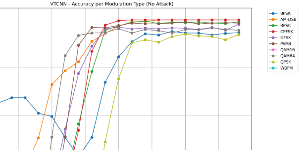

# In-depth Analysis of Communication Signal Modulation Identification: Three Core Models + Four Major Defense Attacks Methodology Fully Explained with Python Code

Deep Insight into Communication Signal Modulation Identification: A Comprehensive Review of Three Core Deep Learning Models + Four Major Defense Attacks Methodologies
In the field of wireless communication intelligent recognition, automatic modulation classification (AMC) is a core technology. The deployment of deep learning models has significantly improved the accuracy of modulation identification. However, defense against attacks and defense against counterattacks have become key factors in determining whether models can be safely applied.
I. Three Core Deep Learning Models for Signal Modulation Identification
This system has implemented three industry-leading, classic communication signal classification models, tailored to different signal characteristics, serving as the standard solution for wireless communication AI recognition.
1. VTCNN model is a lightweight convolutional neural network specifically designed for communication IQ dual-channel signals.
★
Features: Simple structure, fast inference speed, suitable for embedded/edge device deployment;
★
Advantages: High efficiency in extracting features from two-dimensional IQ signals, quick training convergence;
★
Positioning: A baseline model, preferred for rapid validation and light deployment.
2. ResNet18 model is one of the strongest baselines for communication modulation identification through a deep residual network.
★
Features: Introduces residual connections to solve the problems of difficult training and vanishing gradients in deep networks;
★
Advantages: Strong feature extraction capability, good generalization, highest robustness (most resistant to attacks);
★
Positioning: Core main model for high precision and stability.
3. LSTM model is a recurrent neural network specialized for time-series signals, designed to capture the sequential dependencies of signals.
★
Features: Proficient in processing sequence data, aligned with the changing patterns of communication signals;
★
Advantages: Strong understanding of sequential features;
★
Positioning: A dedicated model for time-series signal analysis, complementary to CNN.
✅ Summary: Comparative Capabilities of the Three Models
★
Lightweight and Quick → VTCNN
★
High Precision + Resistant to Attacks → ResNet18
★
Modeling Sequential Features → LSTM
II. Four Major Counterattack Attacks (All White-box attacks, can be black-box migration) The system is equipped with four of the most classic and effective counterattack attack algorithms, specifically designed to "deceive" modulation recognition models, which are core attack methods in communication AI security research.
1. FGSM (Fast Gradient Sign Method) is the simplest, fastest, and foundational attack method among the counterattacks.
★
Principle: Adding small perturbations along the loss gradient direction at once;
★
Features: Single-step attack, minimal computational load, extremely fast speed;
★
Application: Quickly testing model vulnerabilities and generating basic counterattack samples.
2. PGD (Projected Gradient Descent) is currently the strongest and most commonly used iterative attack.
★
Principle: Adding small perturbations multiple times through iterations, and limiting the perturbation within a safe range;
★
Features: Higher success rate than FGSM, standard strong attack;
★
Application: Rigorous testing of model robustness and main attack in defensive and offensive experiments.
3. MIM (Momentum Iteration Method) is an enhanced version of the iterative attack with momentum mechanisms.
★
Principle: Accumulating gradient directions, making the perturbation more stable and attack transferable;
★
Features: Not easily trapped in local optima, better cross-model attack results;
★
Application: Black-box attacks, cross-model transfer attacks.
4. PCA-UAP (Universal Counteracting Perturbation) generates universal perturbations for all samples in one go.
★
Principle: Extracting global perturbation patterns through PCA to generate universal perturbations;
★
Features: No need to calculate for each sample individually, batch attack, highly efficient;
★
Application: Large-scale attacks, low-cost generation of counterattack samples.
III. Core Defense Scheme: Adversarial Training System provides the most effective and practical defense method in the communication field, without exception.
Adversarial Training ★
Approach: Actively incorporate counterattack samples during model training;
Function: Allow the model to "adapt" to perturbations in advance, significantly enhancing its resilience against attacks.
★  
Effect: Facing FGSM/PGD/MIM/UAP attacks, the model accuracy does not drop and the error rate does not surge.
★  
Status: A standard defense solution for the identification and attack of communication signals.
IV. Minimal Summary (the easiest version to remember)✅ Models (3) 1
VTCNN: Lightweight CNN, Fast Baseline
2  
ResNet18: High precision, most robust (strongest model)
3  
LSTM: Time Series Modeling, Specialized for Sequence Signals
✅ Attack methods (4) 1
FGSM: Fast Gradient Sign Method
2  
PGD: The strongest iterative attack (most commonly used)
3  
MIM: Momentum Enhancement, High Transferability
4  
PCA-UAP: Generalized Perturbation, Batch Attack
✅ Defense method (1) ★
Adversarial Training: Robustness Enhancement Standard Solution for Communication AI

## Images

<!-- PAYMENT_BLOCK -->

## Get this dataset

- Payment link (Stripe): [Buy now](https://buy.stripe.com/3cs8yP7sY87d0vu9AB)
- Payment QR code: 

<!-- /PAYMENT_BLOCK -->
